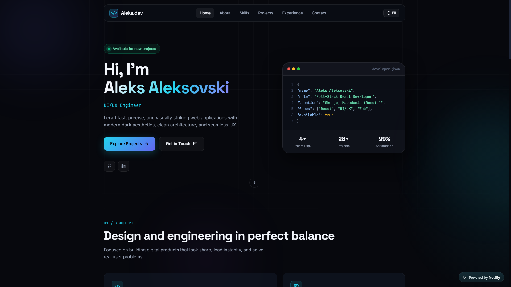

<h2 align="center">🧑 Portfolio Application 🎫</h2>

• 📢 Portfolio Web Site made with React and Node JS.

 

 
<h2 align="left">Live Preview: 🕹️ </h2>

    
• 🖥️  Portfolio Application&nbsp;
    
    

<h2 align="left">Languages and Tools : 🛠️ </h2>

    &nbsp;
    &nbsp;
    &nbsp;
    &nbsp;
    &nbsp;

<!-- /////////////////////////////////////////////// MERN-Projects/PortfolioApp-3 ////////////////////////////////////////////////// -->
